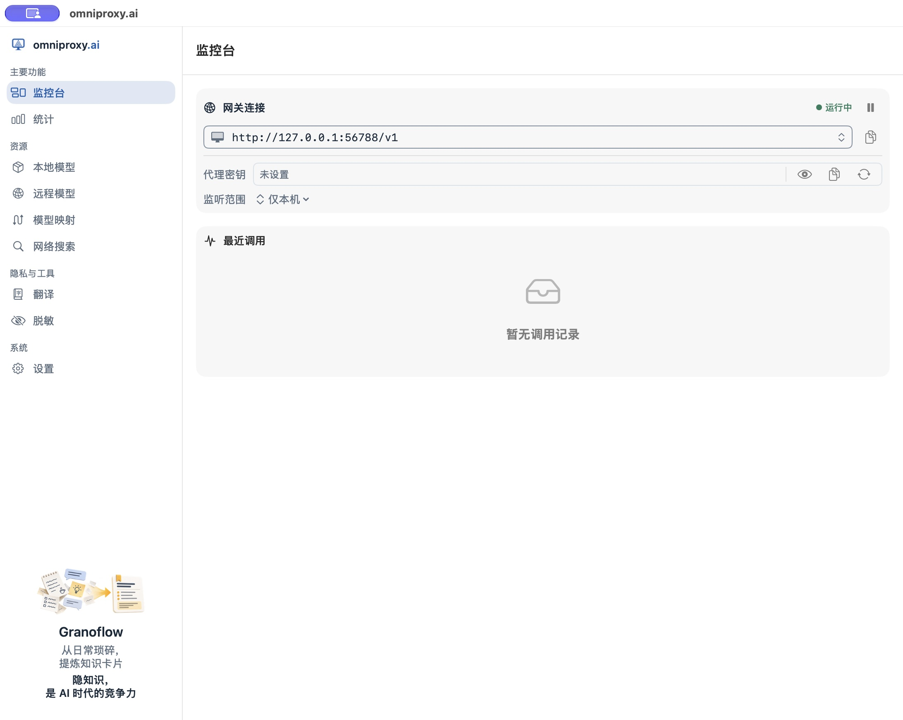

# 第一次连接模型并发起请求

这条路线让你完成一件事：在 OmniProxy 准备一个模型，在支持自定义模型服务的工具里发一条消息，再回到 OmniProxy 找到这次调用。

准备好适合设备的 OmniProxy 安装包。macOS 桌面版打开 OmniProxy.app；独立 CLI 的用法见[命令行参考](12-cli-runtime.md)。请从已确认的正式渠道取得发行物，官网尚未提供下载入口时，不要根据示例猜安装地址。

## 1. 完成首次设置

首次设置依次经过翻译模型、外部模型、网络搜索、确认和完成五页。只想先接外部模型，可以这样走：

1. 翻译模型页选择“不预装翻译模型”，点“继续”。
2. 外部模型页添加你的 API 来源，按[添加来源](06-external-models.md)填写并测试。已添加的每个来源都须验证当前配置，才能继续；修改地址或密钥后重新测试。也可以不添加，进入工作台后再配置。
3. 网络搜索页暂不添加来源，点“继续”；已经添加的来源同样须验证当前配置。
4. 确认页检查下载清单和来源摘要。不想下载的翻译模型仍在清单里时，点“上一步”回翻译模型页改选，再回确认页；不要直接开始下载。
5. 点“确认并开始”，查看执行结果，完成后点“进入工作台”。没有选模型时，不需要为了完成设置下载一个模型。出现失败时先保留错误，不把进入工作台当作模型已经能用。

首次设置遇到失败时：尚未开始执行可用“上一步”回到对应页，改正来源信息并重新测试；下载任务失败时，在任务行查看错误，提供“重试”时修正网络或存储条件后点击它。若提示可以进入工作台，进入后仍需在任务区域处理失败下载，不能把进入工作台当作下载成功。没有可用重试、也不能继续时，记下错误，重新打开 App；仍失败按[启动与连接故障](13-system-states.md)取得诊断信息，不通过删除资料库重置。

如果打开后直接看到左侧导航，可以从下一步开始。遇到启动错误，先读[启动与连接故障](13-system-states.md)。

## 2. 准备一个能调用的模型

任选一条路线：

- 有供应商 API 权限：到[远程模型](06-external-models.md)添加来源，网址填供应商 API 地址，密钥填供应商 API key。先测试读取模型列表，再对目标聊天模型执行调用测试，看到实际回答后继续。这个供应商密钥留在来源配置里，不是稍后给工具填写的代理密钥。
- 想在本机处理：到[本地模型](05-local-models.md)准备模型，完成调用测试并按页面提示加入代理。某些 Mac 会显示由系统管理的 Apple 模型，它不需要另下载权重，但仍需核对实际可用性。

“保存了来源”“下载完成”和“能生成正确回答”是三种不同结果。先看到实际返回内容，再连接常用工具。

## 3. 从监控台取得连接参数

打开左侧“监控台”。网关应处于“运行中”；地址旁的复制图标可以复制当前连接地址。

图中是尚未配置代理密钥、也没有调用记录的起始状态。你的工具要连接的是网关地址，不能把供应商网站地址填到这里代替网关。

首次接入建议先设置代理密钥：在监控台“代理密钥”一行点击“生成密钥”图标，生成后用“复制密钥”图标取得当前值，再填入工具的 API Key。已有密钥时直接复制，不必为添加工具重新生成。重新生成会轮换密钥，原来使用旧密钥的工具也要更新。

未设置代理密钥时，仅本机监听允许无认证访问；工具若强制要求 API Key，不要随便填供应商密钥或猜一个占位值，先按上面步骤生成。切换到“所有网络”前必须配置代理密钥；已设置时，调用须携带正确的代理密钥。

| 工具中的字段 | 应填写什么 |
| --- | --- |
| Base URL / 服务地址 | 监控台中复制的网关地址；按工具要求保留或去掉 `/v1`，避免重复拼接 |
| API Key | OmniProxy 的代理密钥，前提是你已经配置它；不是供应商 API 密钥 |
| Model / 模型 ID | 模型列表复制的完整名称，或已经启用的用途入口，例如 `chat` |

需要给其他设备使用时，先阅读监听范围与认证要求。`127.0.0.1` 只表示运行工具的那台设备自身；它不能让另一台电脑自动找到你的 Mac。不要为排错随意开放所有网络接口。

## 4. 在工具里发一个小任务

先找工具的自定义服务或 OpenAI 兼容配置，填入上面三项并保存。选用已经验证的文本聊天模型，发送“请用一句话解释什么是网关”。如果工具要求厂商专用协议，不能只因为它有模型输入框就当作兼容，见[第三方工具接入](17-tools.md)。

收到回答后检查内容是否回应了问题。某些工具会额外发送工具调用、图片或其他请求，简单聊天成功不能证明这些能力都兼容。

## 5. 回到监控台找到这次调用

按刚才的时间找到最新记录，检查成功/失败、实际来源和实际模型，再打开详情查看可用的请求与响应。完整判定方法见[查看调用记录](02-monitor.md)。

| 现象 | 先做什么 |
| --- | --- |
| 工具连接不到网关 | 确认网关运行、地址正确、工具与网关在同一可达网络 |
| 认证失败 | 核对填写的是当前代理密钥，不是供应商密钥 |
| 模型不存在或名称有歧义 | 重新从模型列表复制完整 ID，或使用已配置的用途映射 |
| 返回能力错误 | 换成已经测试相应能力的模型，不只看名称 |
| 工具报错但监控台没有记录 | 先查工具是否真的向这个地址发送请求，以及失败是否发生在网关接收前 |

完成这条路径后，可以[固定一个用途入口](model-mapping.md)，以后更换模型时减少对工具配置的修改。
