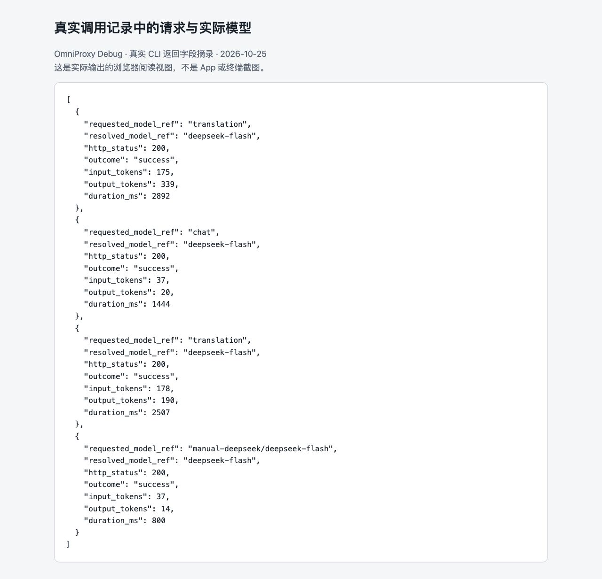

# 查看调用记录与管理网关

当第三方 AI 工具报错、回答异常，或者你想确认请求究竟发往了哪个模型时，请打开左侧导航栏的**监控台**。在这里，你可以控制网关启停、管理代理密钥，并逐条检查最近的调用记录。

*上图为原生 App 的监控台初始界面。图中显示“暂无调用记录”代表当前隔离环境尚未收到任何请求，并非一次调用成功的结果。日常排查时，请先从外部工具发起一次小任务，再回到此处核对。*

## 1. 查找并核对刚刚发出的请求

1. 在你的 AI 工具中发送一句容易辨认的简短提问，记下发送的大致时间。
2. 切回 OmniProxy 的**监控台**，在“最近调用”列表中按时间找到对应的记录行。
3. 先看列表摘要中的**状态（成功/失败）**、**耗时**与**实际模型**；再点开该条记录，查看当前保存的完整请求与响应详情。
4. 对照详情排查：确认实际执行的模型是否符合预期、返回正文是否非空，以及报错究竟来自本机网关拦截还是上游供应商返回。

> **为什么一次提问会产生多条记录？**
> 许多具备 Agent 或联网能力的工具在完成一次任务时，会在后台连续发起多轮请求（例如：先让模型做任务规划，再发起工具调用、塞入参考资料，最后生成总结回答）。看到多条记录时，请勿立刻判定为网关重复发包或异常计费；先逐条点开比对它们的时间先后、请求目标与消息正文。

*上图为 CLI `logs list` 真实返回字段的浏览器阅读视图（非原生 App 截图）。图中展示了外部工具请求名称为 `chat`、网关实际路由并执行的模型为 `deepseek-flash`；状态码 `HTTP 200` 与 `success` 代表请求已完成。在界面上看到成功状态后，仍建议点开详情核对返回正文是否真正回答了问题。*

## 2. 从调用记录中能读出哪些信息

| 记录中的字段 | 帮你判断什么问题 |
| --- | --- |
| **时间、状态与耗时** | 请求何时到达网关、是否成功完成，以及卡顿或超时具体发生在哪一跳调用。 |
| **实际来源与实际模型** | 工具请求的用途名称（如 `chat`）或虚拟模型名，最终被转发给了哪个供应商的哪个具体模型。 |
| **请求详情（Request）** | 第三方工具在后台真正发来的完整消息数组、系统提示词、参数及附件结构，而不只是工具聊天框里显示的那一句话。 |
| **响应与错误（Response / Error）** | 上游模型实际生成了什么内容；若失败，具体是网关代理密钥认证错误、模型能力不支持，还是上游接口限流报错。 |

**阅读记录时的注意事项**：
- 记录仅展示实际落盘且协议允许公开的字段，无法查看云端模型在厂商后台隐藏的内部推理过程（未公开的思维链）。
- 对于本来就不含正文的请求、因超出存储上限而被清理了旧正文的历史记录，或者中途断开的流式（Streaming）响应，请以详情页实际展示的状态说明为准。

## 3. 在监控台找不到记录怎么办？

如果外部工具已经报错，但监控台的“最近调用”里空空如也，请按以下顺序排查：

1. **检查工具请求地址与网关状态**：确认工具里的 Base URL 确实指向当前监控台的地址，且网关处于**运行中**。若请求在发出前就被客户端拦截、填错了端口，或在到达网关前因网络不通而失败，监控台自然不会留下记录（但也切勿仅凭列表为空就断定底层模型本身坏了）。
2. **核对时间范围与历史清理**：检查筛选的时间范围是否包含了刚才的操作时间。注意：当日志占用达到上限时，较早记录的请求/响应正文可能会按保留策略被清理，但[看懂用量与缓存统计](03-statistics.md)中的汇总计数仍会保留。
3. **分清运行实例**：独立 CLI 与桌面端 App 拥有各自独立的数据目录。如果你调用的是独立 CLI 启动的网关，请勿到桌面端 App 的监控台里找记录（反之亦然）。

## 4. 暂停代理与轮换代理密钥

监控台顶部的网关连接区提供了网关运行控制与凭据管理入口：

- **暂停与恢复代理**：点击**暂停代理**会立即停止接收后续的新请求，但**不会**强行中断网关已经受理并正在处理中的请求。如需暂停网关或修改上游配置，建议先等待工具里正在生成的回答结束；已发出的请求是否完成，仍需通过调用记录确认，不要把“暂停代理”当成取消当前请求的终止键。若网关监听地址或端口发生变化，请按[快速上手](01-getting-started.md)重新更新外部工具中的配置。
- **管理代理密钥**：本机网关的**代理密钥**用于认证你的外部 AI 工具，与上游供应商的 API Key 互不相干。在“代理密钥”一行：
  - 点击**眼睛**图标可显示或隐藏当前密钥明文。
  - 点击**复制密钥**可将当前密钥复制到剪贴板。
  - 点击**生成密钥**会生成并立即保存一把新密钥（首次创建与后续定期轮换均使用此按钮）。注意：一旦重新生成，旧密钥即刻失效，请同步更新所有外部工具中的 API Key 并发送一条短请求验证。切勿将暴露明文密钥的界面截图直接公开分享。

## 5. 安全分享排错信息

向他人或维护团队求助排错时，请先整理好外部工具名称及版本、操作时间、所用模型名称与具体错误提示。**在发出任何截图或复制的日志文本前，请务必手动检查并抹除代理密钥、上游凭据、个人隐私路径、未脱敏的业务原文及附件内容**——调用记录里保存的是你的真实交互数据，不会因为“拿去排错”就自动脱敏。
