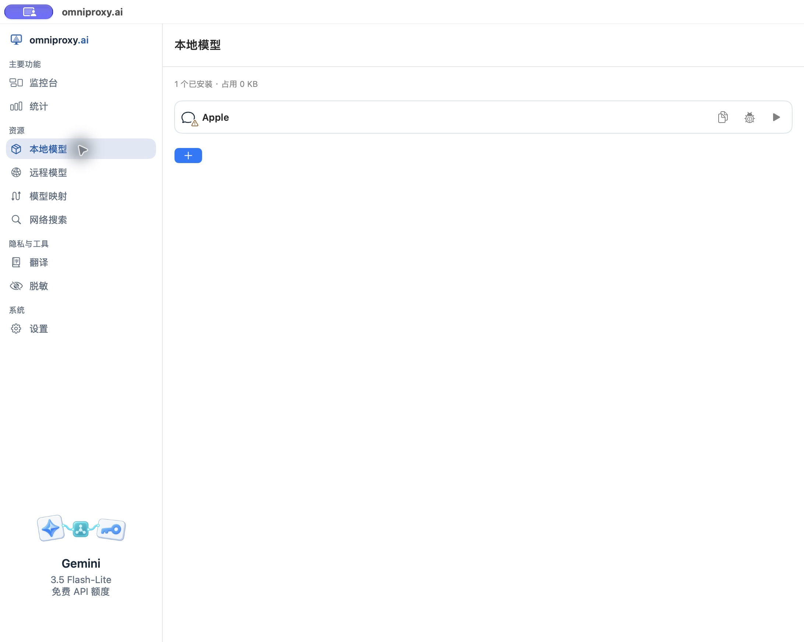
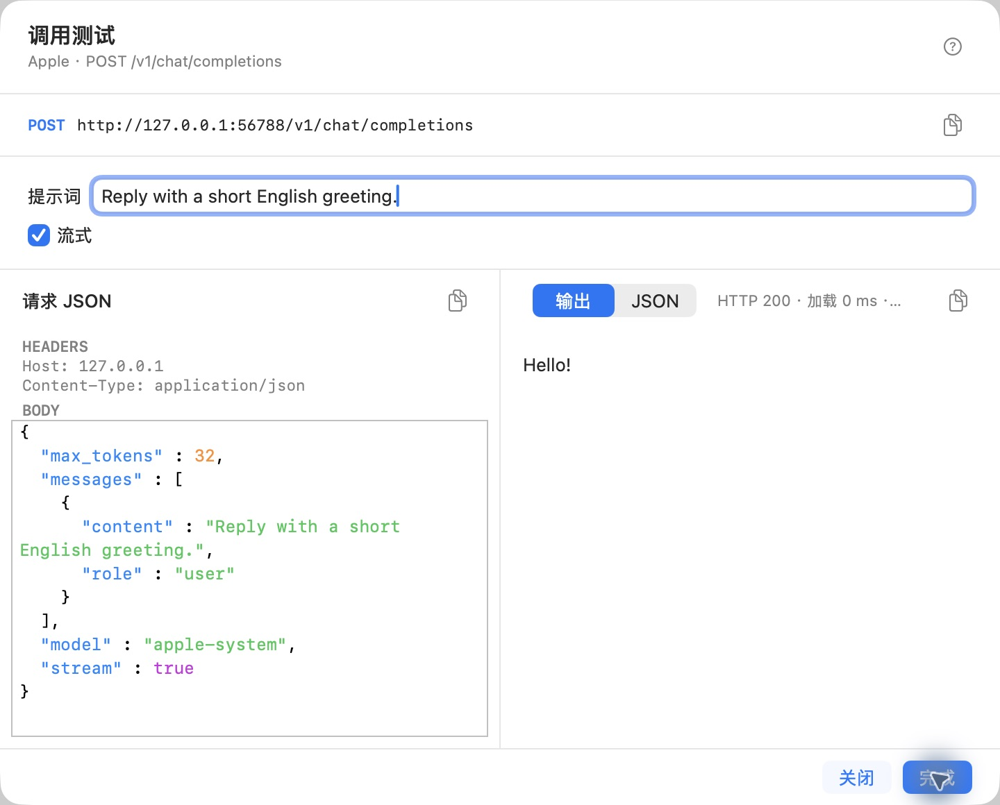

# 使用本地模型

本地模型由你的电脑执行。选择时先看要完成的任务，再看设备和存储是否满足要求；不要只按模型热度或参数大小下载。

## 先读懂已安装列表

打开左侧“本地模型”。每项可查看状态、复制完整模型名称，并进入调用测试；具备条件后才能加入代理。

图中的 Apple 是由 macOS 管理的系统模型，显示“需要重新测试”。它不占用 OmniProxy 管理的模型权重目录，因此不能按“0 KB”理解为普通模型只有这么大。只有系统当前可用的设备才会出现相应选项；OmniProxy 不能下载、移动或删除它。

## 找到并下载一个模型

1. 点击已安装列表下方的加号，打开模型目录。
2. 按任务查找模型，例如对话、翻译、图像或语音；阅读设备适用性与当前可执行状态。
3. 查看具体模型工件、大小与许可要求，不把同一家族的不同量化版本混为一份文件。
4. 下载前确认默认下载位置有足够空间，外置存储已经连接且有访问权限。
5. 在下载确认中核对实际文件清单，再开始下载。
6. 等待下载和校验结束，回到已安装列表进行调用测试。

目录里能看到某个名字，不等于当前设备能运行它；支持一种文件格式，也不表示该格式里的所有模型都受支持。

## 目录暂时不可用时

这是一张真实故障状态图。此时还没有可选择的目录，不要反复点击下载。检查网络后使用“重试”；暂时无法恢复可取消，继续使用已安装且可用的模型。它不表示已安装的权重被删除。

## 测试并加入代理

1. 点击模型行的调用测试图标。
2. 选择该模型支持的能力和调用方案，填写最小输入；例如聊天先输入一句短问题。
3. 运行后检查实际文本、图片或音频结果；错误、空响应或格式不正确都不算完成。
4. 若打开的是“接口调试”，保存 Header/JSON 只供下次调试使用；手工标记测试结果也不能代替真正加载和能力验证。检查 HTTP 状态后仍要阅读返回内容。
5. 使用“加入代理”时，必须通过当前安装的静态检查、实际加载和能力验证。未通过会返回验证，不会因为保存过调试 JSON 就强行加入。系统模型的入口在模型行；自定义接口调试中的“加入代理”在调试窗口中。
6. 已加入的模型行会提供启用/停用代理入口，确认处于启用状态。普通工具直接使用该模型时不必先设置用途映射；需要固定 `chat` 名称时再去[模型映射](model-mapping.md)。最后从工具发起真实请求，在监控台确认实际模型。

| 状态 | 下一步 |
| --- | --- |
| 下载中或文件未校验 | 等待完成或按当前任务提供的恢复操作处理 |
| 已安装 | 进行实际调用测试，不能只根据文件存在判断可用 |
| 需要重新测试 | 重新测试当前模型和当前调用方案 |
| 已测试但没有加入代理 | 按模型行的准入操作处理，再检查网关模型列表 |
| 设备不支持 | 选择其他受支持工件，不强行加载 |

## 管理多个模型位置

在“设置”找到“模型存储”。“默认下载位置”决定新下载写到哪里；“更多模型文件夹”用于登记其他已有目录。

1. 要将管理的模型存储和后续下载放到移动硬盘或 NAS，先连接存储，用默认位置旁的“更改位置”选择并授权新目录；阅读容量与迁移影响，再确认开始迁移。等待验证和切换完成后再下载，不能只选完目录就拔掉原磁盘。详见[存储设置](04-settings.md)。
2. 想原地使用其他工具的模型，展开“更多模型文件夹”，添加实际保存模型的目录。
3. 回到模型页查看识别结果、物理副本和可用状态。相同名字不证明文件相同；现成目录也必须满足模型识别和运行条件。
4. 确认测试成功后再用于代理；添加目录不会自动安装其他工具的运行环境。

目录授权失效时，到设置的模型存储或相应文件夹条目重新选择原目录并授权；目录在线但没有识别出模型时，先核对具体工件与引擎支持、目录中是否确实有完整文件，不反复登记同一个目录来代替识别。默认位置不可用时先恢复连接或按迁移流程明确选择新位置，不假定网关会自行换一个磁盘继续写入。移除目录登记、移动文件与删除模型是不同操作，执行前阅读确认范围。

本地模型列表没有单独的“移动模型”操作。要移动 OmniProxy 管理的模型存储，使用上面“默认下载位置→更改位置”的迁移流程；只想原地使用已有外部模型就登记原目录。不要先在文件管理器搬走文件，再期待原登记路径继续可用。

## 删除、更新与 Apple 模型

删除下载或模型前，先停止相关任务并处理映射引用。外部目录中由其他工具管理的原文件不能当作 OmniProxy 垃圾随意清理。模型或调用方案更新后，旧测试证据可能失效，需要重新验证。

Apple 系统模型不能通过 OmniProxy 下载、移动或删除；不要把它当作下载的权重文件处理。Apple 系统聊天模型的可用性由系统决定，可能受设备、系统设置、语言及任务能力限制。不支持时不会因为它叫“本地模型”就自动换成云端服务。它也可能出现在[对话模型代译](10-glossary-translation.md)的候选中。

还不确定模型大小或格式的区别，先看[参数与量化](07-params-quantization.md)。

## 成功调用示例

在受支持的 Mac 上，Apple 系统模型就绪后，打开这一行的调用测试，输入 `Reply with a short English greeting.` 并运行。下图返回 `Hello!`，状态为 HTTP 200，同时显示首个 token 时间和生成速度。确认输出后再使用“加入代理”；成功后该操作变为“关闭代理”。Apple 系统模型由系统管理，这个示例不涉及下载第三方模型权重。

