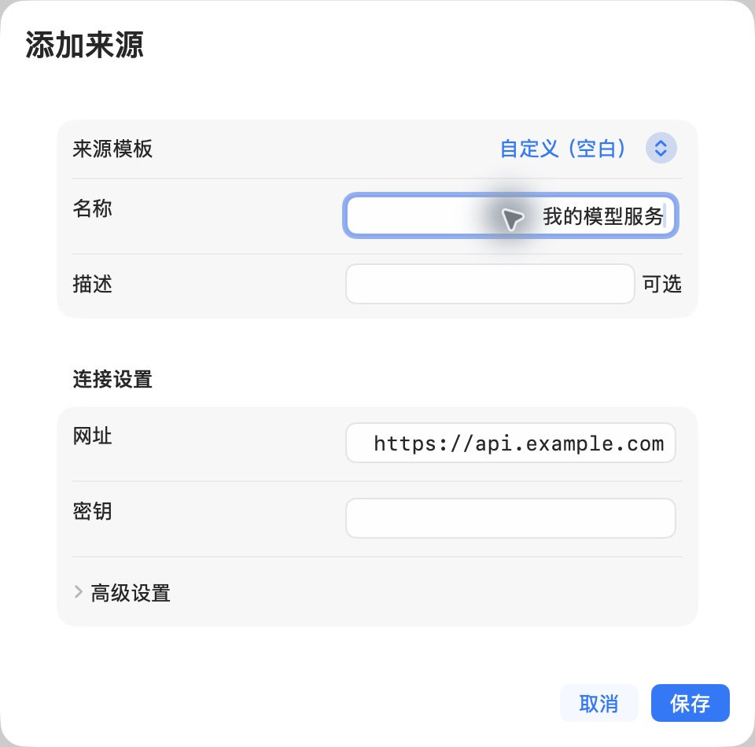
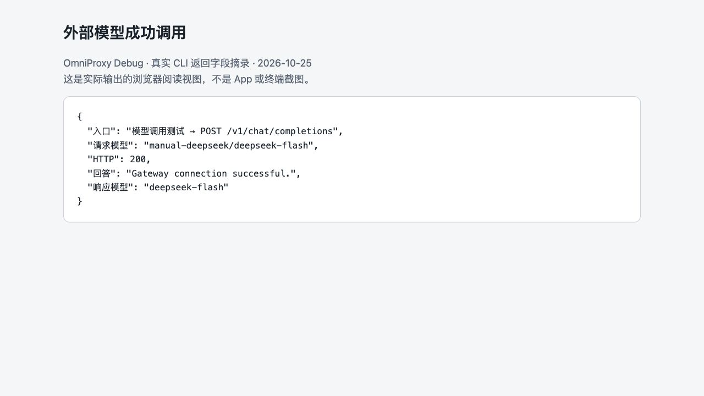

# 连接外部模型服务

本章教你把服务地址和供应商密钥保存在 OmniProxy，让 AI 工具连接网关。以后供应商地址或密钥变化，优先在这里调整并验证，工具继续使用网关入口。

开始前准备：供应商提供的 API 地址、可用 API 密钥、打算使用的模型及计费权限。网页聊天账号或会员不一定包含 API 权限。调用外部模型会向对应服务发送请求内容。

## 添加来源

1. 在左侧打开“远程模型”。
2. 点击来源列表下方的加号，打开“添加来源”。
3. 有适合的“来源模板”就先选择；没有则使用“自定义（空白）”。
4. “名称”填便于自己辨认的名字，例如“工作模型服务”；“描述”可以不填。
5. “网址”填供应商 API 地址。“密钥”填供应商给你的 API key。不要在名称或描述里写密钥。
6. 需要明确协议或供应商特有设置时，展开“高级设置”；不熟悉的 JSON 字段先保留默认值，不照抄另一家服务的配置。
7. 保存后查看来源详情，使用测试或刷新模型操作，确认当前配置能读取模型目录。

图中的 `https://api.example.com` 只是填写位置的示例，不是真实服务地址。密钥栏没有填写；这张图表示配置步骤，不表示来源已经连接成功。当前表单不要求填写“命名空间”。

## 目录验证与真实调用分别检查

目录验证证明服务地址、认证和模型目录读取可用，不会证明模型能完成你的任务。取得目录后，再做一次调用测试：

1. 在来源详情中找到目标模型；需要时使用搜索或类别筛选。
2. 点击对应的调用测试入口，选择实际要使用的协议与能力。
3. 输入没有隐私的短问题，运行测试。图像、语音、视频等任务应使用各自支持的测试输入。
4. 查看错误或返回内容，确认回答非空且确实响应了输入。
5. 到[监控台](02-monitor.md)核对实际来源与模型。

模型列表里的一项只代表目录中有它。模型名称也不能单独证明它支持看图、工具调用或视频生成。

## 用一条短请求确认成功

以 DeepSeek 为例，在“来源模板”选择 DeepSeek，使用模板提供的 API 地址 `https://api.deepseek.com`，密钥填自己的 API key。模板会带入相应连接方式，不需要寻找另一个“协议”下拉框。本次命令行验证使用同一服务的 `/v1` 地址，两者不要与供应商的网页聊天网址混淆。先刷新目录，从实际返回的目录选择模型；本次示例选到 `deepseek-flash`，以后目录或模型名变化时按当前列表选择。

在该模型的调用测试里输入 `Reply exactly: Gateway connection successful.`，运行后应检查 HTTP 状态和回答。本次实际返回 `Gateway connection successful.`，HTTP 200；监控记录中的实际模型为 `deepseek-flash`。如果读目录成功却没有这个回答，仍需检查调用结果，不能把来源验证当作生成成功。

这是 CLI 实际返回字段的浏览器阅读视图，供你对照成功结果，不是 App 截图。

## 把工具连接到网关

从[监控台](02-monitor.md)复制网关地址和代理密钥；从模型列表复制完整模型名称。供应商 API key 留在来源配置中，不应再分散填进每个工具。

多个来源提供相同模型时，裸名称可能产生歧义。使用当前模型列表提供的明确引用，或者[配置用途映射](model-mapping.md)，不要假定网关会自动挑一个来源。

## 更新地址、密钥或停用来源

选择左侧对应来源，修改连接设置。更换密钥使用页面提供的替换操作，不把空白输入框理解为“已有密钥一定被清空”；以保存后的状态和测试结果为准。重新测试当前配置，再用工具运行原来的小任务。

替换这里只会更新 OmniProxy 保存的凭据，不会到供应商控制台撤销旧密钥；需要作废旧密钥，还须到供应商控制台处理。为避免影响正在使用的工具，先让正在进行的请求结束，再换密钥或停用来源。停用不能当作取消已经发送给供应商的请求；已发请求的最终结果看调用记录，改好后再用一条新请求验证。

只想暂时停用时，使用来源行的开关。删除前确认是否仍被用途或虚拟模型引用，避免留下没有目标的入口。更换供应商也不一定意味着模型 ID 和协议都能保持相同，稳定入口的设置见[用途映射](model-mapping.md)。

## 失败后怎么办

| 提示或现象 | 操作 |
| --- | --- |
| 连接失败、地址不可达 | 检查 API 地址和网络；不要用供应商官网首页代替 API 地址 |
| 认证或权限失败 | 到供应商控制台检查 API 凭据、模型权限与账号限制 |
| 额度不足或限流 | 查看供应商额度和速率限制，按其要求处理后再试 |
| 配置修改后变为未验证 | 对当前配置重新测试，不沿用旧验证结果 |
| 能读目录但调用失败 | 打开该模型的调用测试，检查协议、请求格式和能力要求 |
| 多个来源同名模型冲突 | 明确选择来源目标，或绑定一个用途入口 |

自建 Ollama 服务也属于外部来源：由你自行安装和运行，OmniProxy 通过它的 API 连接，不替你管理 Ollama 进程。协议与高级接入见[API 参考](14-help-api.md)。
