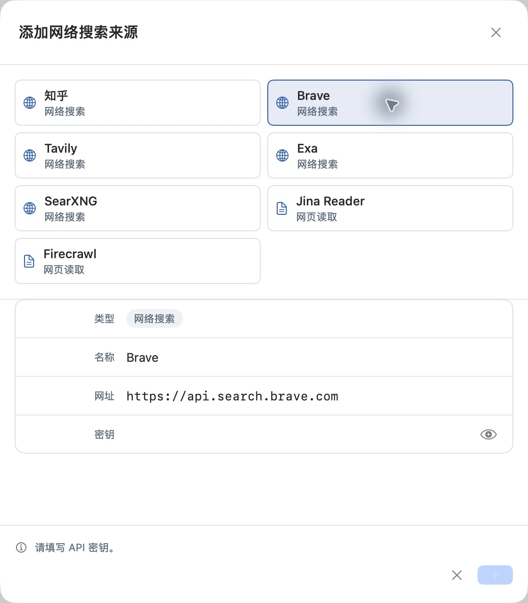
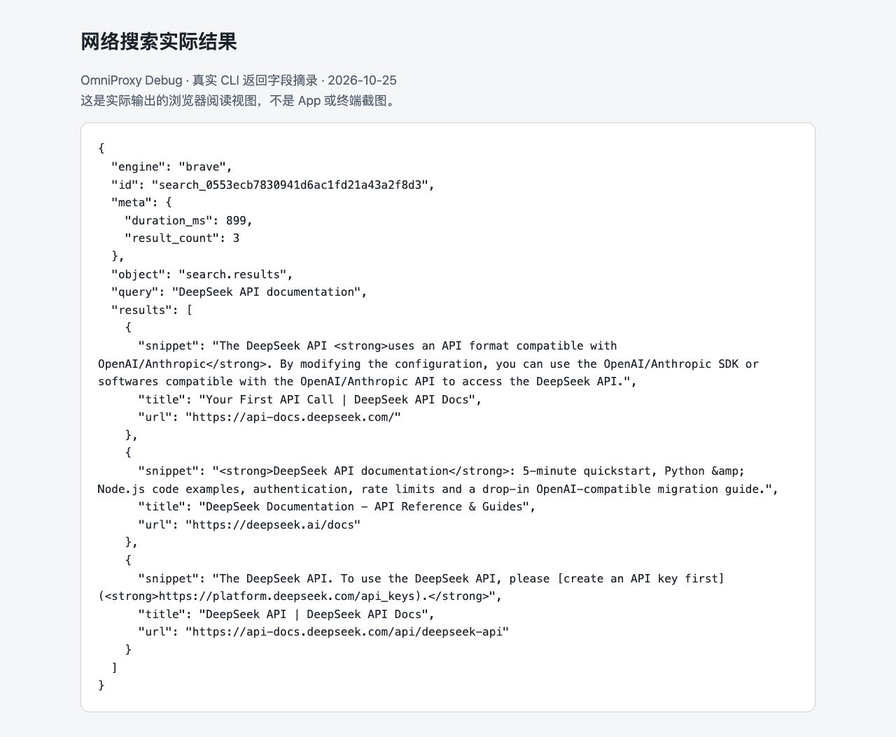

# 配置网络搜索与网页读取

OmniProxy 支持接入两类互联网检索能力，供你或支持该能力的 AI 工具调用：
- **网络搜索（关键词检索）**：输入搜索词，返回相关网页的标题、摘要与原文链接（支持 **知乎、Brave、Tavily、Exa、SearXNG**）。
- **网页读取（正文提取）**：输入已知的具体网页完整 URL，读取并提取该网页的正文内容（支持 **Jina Reader、Firecrawl**）。

**使用前须知**：
- **独立能力边界**：在 OmniProxy 中添加搜索或读取来源，**不会**让所有普通的模型聊天请求都自动联网。AI 工具必须显式调用搜索/读取接口，或者由你将检索结果传给模型。此外，拿到搜索摘要不代表模型已读过网页全文，也不保证模型最终回答的事实绝对准确。
- **隐私与计费**：你的查询词或目标 URL 会发送给所选的外部检索服务商（部分服务需独立绑卡付费）。如需在发送前过滤敏感词，请按[设置发送前文本脱敏](11-redaction.md)为该搜索来源单独开启策略——模型来源的脱敏开关不会自动覆盖搜索来源。

## 1. 添加检索来源

1. 打开左侧导航栏的**网络搜索**，点击左下角的**加号（+）**。
2. 选择要接入的服务类型：
   - **网络搜索**：知乎、Brave、Tavily、Exa、SearXNG（自建 SearXNG 请填写你自己的可达服务地址）。
   - **网页读取**：Jina Reader、Firecrawl。
3. 核对“名称”和“网址”，按所选服务的字段说明填入对应的 API Key 或 Access Secret（切换服务类型时请重新阅读字段提示，不要把知乎的 Access Secret 填到其他服务的 API Key 栏位）。
4. 保存后进入来源详情页，对当前配置执行**测试**，确认状态为已启用且验证通过。
5. 日后若修改了服务地址或凭据，必须重新执行验证，系统不会沿用修改前的成功状态。



*上图为原生 App 的“添加网络搜索来源”窗口（当前选中 Brave，因尚未填写密钥，右下角“添加”按钮呈禁用状态）。*

## 2. 使用关键词“网络搜索”（知乎 / Brave / Tavily / Exa / SearXNG）

### 在桌面端 App 中调试搜索

当列表中至少存在一个**已启用且当前配置验证通过**的网络搜索来源时，页面右上角的**打开搜索接口调试**图标才会点亮可用：

1. 点击右上角**打开搜索接口调试**，选择已验证的搜索引擎（如 `brave`）。
2. 在请求 JSON 编辑框中填入完整的请求结构（注意：不要删掉 JSON 结构只填一个裸词），点击运行。可直接复制以下测试请求：

```json
{
  "engine": "brave",
  "query": "DeepSeek API documentation",
  "limit": 3
}
```

3. 检查返回结果中的网页标题（`title`）、摘要（`snippet`）和原文链接（`url`），并可点开链接核对上下文。若返回空列表，请先尝试更换更明确的查询词，不必立刻判定为配置损坏。

> **参数与同名引擎冲突说明**：
> - **`limit` 范围**：公共接口允许的范围是 `1`–`20`（不填时默认为 `8`）。若填入超出范围的数字，网关会直接拒绝请求，而不会自动截断为 `20`；实际返回条数少于 `limit` 也属于正常现象。
> - **消除 `search_source_ambiguous` 歧义**：网关不支持在公共搜索请求里传内部来源 ID，也不会自动聚合多个同类型来源。如果你为同一个引擎（例如同时添加了两个 Brave 来源）启用了多个验证通过的来源，调用时会报错 `search_source_ambiguous`。请回到**网络搜索**列表，将不用的同引擎来源停用，确保每个目标引擎下**只有一个已启用且已验证的来源**（其他不同引擎如知乎、Tavily 无需停用）。

在本次真实调用中，上述请求成功返回 3 条结果（其中包含标题 `Your First API Call | DeepSeek API Docs`，链接 `https://api-docs.deepseek.com/`）。搜索结果会随时间动态变化，测试时只需确认能正常返回标题、摘要、有效链接及结果计数即可。



*上图为 CLI 真实返回结果的浏览器阅读视图（非原生 App 截图），展示了 Brave 引擎返回的 3 条结构化搜索结果。*

### 从命令行（CLI）或 HTTP API 调用搜索

- **独立 CLI 调用**：独立 CLI 与桌面端 App 的数据相互隔离。若要在 CLI 中执行搜索，须先在该 CLI 实例中配置并验证搜索来源（不要直接拷贝 App 数据库）。先用 `omniproxy search query --help` 核对当前版本用法，随后运行：

```sh
omniproxy search query "本周开源模型更新" --engine brave --limit 3 --output json
```

CLI 的 JSON 输出请先检查外层 `ok` 为 `true`，再从 `data.results` 读取 `title`、`snippet`、`url`，从 `data.meta.result_count` 读取实际返回条数。

- **HTTP 网关调用**：如果搜索来源配置在桌面端 App 中，除了在 App 内调试，你也可以直接向 App 监控台的网关地址发起独立的 `POST /v1/search` 请求（注意：HTTP 响应直接返回搜索结果对象，不带 CLI 的 `ok/data` 外层包装；且搜索必须走独立端点，不能靠在普通聊天请求里随便塞一个 `web_search` 字段来触发，完整 `curl` 示例见[命令帮助与网关 API 参考](14-help-api.md)）。

## 3. 使用“网页读取”提取正文（Jina Reader / Firecrawl）

Jina Reader 和 Firecrawl 属于网页正文读取（`web_read`）服务，接收的是**完整的目标网页 URL**，不能使用仅接收关键词搜索引擎标识的 `search query` 命令或 `POST /v1/search` 接口来调用。

- **在桌面端 App 中测试读取**：在**网络搜索**列表中找到已添加的 Jina Reader 或 Firecrawl 来源，点击该来源行的**功能测试**入口。系统会按所选服务商提供标准的网页 URL 测试示例，运行后即可直接查看实际的请求与网页正文响应。
- **在独立 CLI 中验证与读取网页**：同样需先在当前独立 CLI 实例中配置好对应的读取来源，随后使用 `retrieval` 命令组按来源 `<id>` 操作（先运行 `omniproxy retrieval --help` 查看详情）：

```sh
# 1. 列出当前 CLI 实例中的检索来源，获取目标 Jina Reader 或 Firecrawl 的来源 <id>
omniproxy retrieval list --output json

# 将下面的值替换为上一步列出的网页读取来源 ID
OP_RETRIEVAL_ID='替换为网页读取来源ID'

# 2. 使用一个完整的网页 URL 验证该来源配置是否可用
omniproxy retrieval verify "$OP_RETRIEVAL_ID" --input "https://example.com" --output json

# 3. 实际读取指定网页 URL 的正文内容
omniproxy retrieval query "$OP_RETRIEVAL_ID" "https://example.com" --output json

# 4. 查看该来源最近一次验证的请求/响应交换详情
omniproxy retrieval exchange "$OP_RETRIEVAL_ID" --output json
```

## 4. 常见故障排查

| 遇到的现象 | 排查与处理步骤 |
| --- | --- |
| **右上角“打开搜索接口调试”图标呈灰色** | 检查列表中是否至少有一个**网络搜索**类来源（非网页读取）处于“已启用”且“当前配置验证通过”状态。 |
| **报认证失败或额度不足** | 检查对应检索服务商的 API Key / Access Secret、权限与账户余额；切勿拿大模型供应商的 API Key 冒充搜索凭据。 |
| **报错 `search_source_ambiguous`（来源有歧义）** | 同一搜索引擎（如 Brave）下存在多个已启用且验证通过的来源，请停用多余项，仅保留一个活动来源。 |
| **搜索成功但返回空列表** | 尝试缩短或更换更具体的查询关键词、调整 `limit` 数量，并核对返回状态码。 |
| **能读取指定 URL 网页，却无法按关键词搜索** | 你当前只添加了网页读取来源（Jina Reader / Firecrawl），请另外添加 Brave、Tavily、知乎等关键词搜索来源。 |
