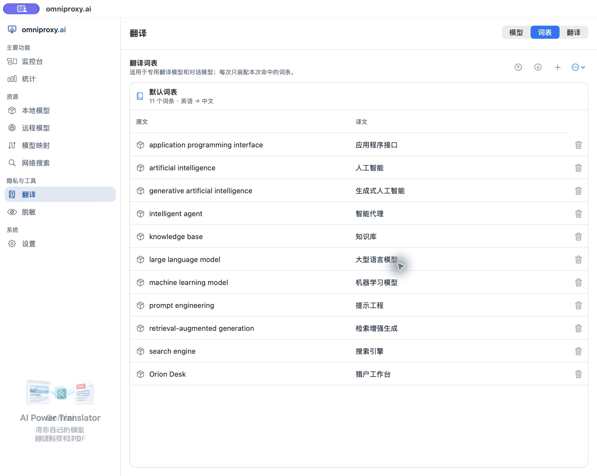
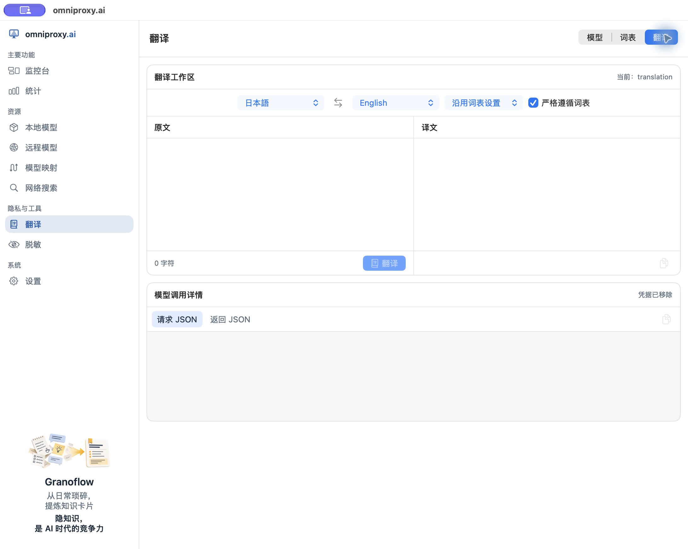
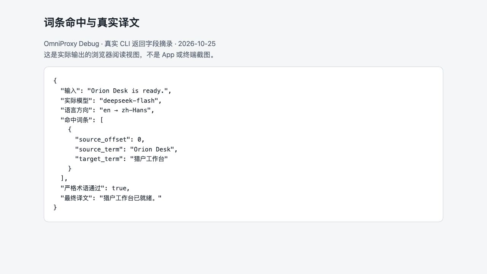

# 管理词表与使用翻译工作区

在翻译产品文档或专业材料时，**词表**用来固定专有名词的译法（例如将虚构产品名 `Orion Desk` 统一译为“猎户工作台”），而**翻译**工作区则调用你指定的翻译引擎执行文本转换。

**使用前须知**：
- **两个独立菜单入口**：在左侧导航栏中，**词表**与**翻译**是两个并列的独立入口，分别负责维护术语库与执行翻译任务。
- **词表的作用边界**：词表仅用于约束命中术语的译法，不能自动保证整篇译文的语法和上下文百分之百准确。此外，并非所有流经 HTTP 网关的普通聊天请求都会自动经过翻译工作区或套用词表。

## 1. 在“词表”中添加专业术语

1. 点击左侧导航栏的**词表**。
2. 检查当前词表的**语言方向**（例如默认词表为“英语 → 中文”）。
3. 点击页面右上角的**加号（+）“添加词条”**。
4. 在“原文”栏填入 `Orion Desk`，在“译文”栏填入 `猎户工作台`，点击保存。
5. 返回词表列表，确认新增的词条已出现在表格中且拼写无误。



*上图为原生 App 的“词表”管理界面（使用虚构产品名演示）。词条保存成功仅代表已写入本地词库；它能否在翻译中真正生效，还需要在接下来的实际翻译调用中验证。*

## 2. 准备翻译引擎

打开左侧导航栏的**翻译**，切换到右上角的**模型**视图查看可用引擎。你可以使用以下两类翻译引擎：

- **专用翻译模型**：已就绪的专用翻译模型会直接在此处列出。其中，本地翻译模型的下载与删除请前往左侧**本地模型**（见[下载与管理本地模型](05-local-models.md)）；外部云端翻译服务的接入请前往左侧**远程模型**（见[添加云端模型服务](06-external-models.md)）。
- **对话模型代译**：你也可以指定一个已验证的通用对话模型来承担翻译任务。系统内置了翻译系统指令；如果不确定如何调整提示词，请直接保留默认指令，切勿把一段待翻译的业务原文误填成系统指令。
  - *关于 Apple 系统模型代译*：在受支持的 Mac 上，系统托管的 Apple 聊天模型也会出现在代译候选列表中（无需下载权重）。但它的可用性完全受 macOS 系统限制；若遇到不支持的语言对或任务，它会明确报错返回失败，**不会**在后台自动替你切换成其他云端模型。

> **注意**：翻译工作区内的引擎配置与**模型映射**中的用途映射并非自动实时同步，请在实际翻译前确认工作区已选好可用目标。

## 3. 在“翻译”工作区执行带词表的翻译

1. 先为翻译任务选定可用引擎（按需在工作区或[用固定名称映射模型](model-mapping.md)中启用翻译目标）。
2. 在左侧**翻译**页面确保位于右上角的**翻译**主视图，核对**源语言**和**目标语言**（例如“英语 → 简体中文”），避免沿用上一次任务的错误语言方向。
3. 在**词表**下拉选择器中，确认本次任务是“沿用设置”、“指定具体词表”还是“不使用词表”——如果要验证术语效果，切勿选成“不使用词表”。
4. 开启或保持勾选**严格遵循词表**，在左侧输入框填入测试句：

```text
Orion Desk is ready.
```

5. 点击运行，先检查右侧译文中是否准确包含了“猎户工作台”，再通读整句译文是否通顺。你还可以点开模型调用详情核对实际发出的请求与返回结构（对外分享前请先检查并抹除原文隐私）。



*上图为原生 App 的“翻译”工作区初始空白状态（此时尚未配置可用的翻译目标）。实操本页示例前，请先为翻译用途绑定已验证的来源与模型并开启，再回到此处选择“英语 → 简体中文”及对应词表；右侧输出框为空白并不代表翻译成功。*

### 严格术语检查与后端兼容性说明

在本示例中，将翻译目标绑定到已验证的 DeepSeek 模型后，输入 `Orion Desk is ready.`，实际返回译文为“猎户工作台已就绪。”。调用详情明确显示命中词条 `Orion Desk → 猎户工作台`，且**严格术语检查通过**——看到这一步，才算真正验证了本次译文已采纳词表。



*上图为翻译真实输出字段的浏览器阅读视图（非原生 App 截图）。你可以通过比对输入文本、命中的词条明细、严格术语检查状态与最终译文，确认词表是否真正生效。*

- **“严格遵循词表”的重试机制**：开启该选项后，如果模型第一次生成的译文没有包含命中的目标译法，支持该机制的流程最多会自动追加尝试一次修正；若重试后仍未满足，系统会给出警告提示。请务必人工核对最终译文，不要把勾选该开关当成“百分之百无条件命中”的绝对保证。
- **不支持词表的后端不伪装成功**：部分专用翻译接口（如原生翻译后端或 Qwen MT 等）本身不支持传入术语词表。当你的原文命中了本地词条、但所选后端不支持消费词表时，系统会明确报错提示不支持，绝不会假装已经应用了词表。遇到这种情况，请更换支持词表的对话代译模型，或者在本次任务中显式将词表设为“不使用”。

### 在独立 CLI 中运行翻译

如果你使用独立 CLI 实例（需已在该 CLI 实例中配置好模型与词表），可以使用 `translate` 命令组查看引擎并执行翻译（运行前可先通过 `omniproxy translate --help` 查看完整参数）：

```sh
# 查看当前 CLI 实例的翻译配置与可用翻译引擎
omniproxy translate config get --output json
omniproxy translate engines --output json

# 执行一次从英语到简体中文的文本翻译
omniproxy translate run --input "Orion Desk is ready." --source-language en --target-language zh-CN --output json
```

## 4. 批量导入、导出与恢复词表

少量词条可直接在界面上逐条添加；如需批量维护成百上千条术语，建议**先点击“导出”获取标准 CSV 模板**，在导出的文件基础上修改后再导入，不要凭印象手写文件结构。

### CSV 文件格式规范
- **编码与大小**：必须使用**无 BOM 的 UTF-8** 编码，文件大小不超过 `512,000` 字节。
- **表头与列数**：固定为两列，第一行表头必须严格写作 `SourceTerm,TargetTerm`；后续每行均须包含两个非空值。
- **唯一性校验**：`SourceTerm`（原文）在忽略首尾空白字符与字母大小写后**不能重复**。凡是存在重复原文、列数不对、带有 UTF-8 BOM 头或超出体积上限的文件，导入校验均会直接拒绝。

最小合法 CSV 内容示例：

```csv
SourceTerm,TargetTerm
Orion Desk,猎户工作台
```

### 理解“整份覆盖”与“恢复内置版本”
- **导入即全量替换**：对同一个词表执行 CSV 导入时，系统会**用新文件完整替换你当前的用户词表版本**，而不是在末尾追加几行。因此在导入覆盖前，请务必先导出并妥善保管具有恢复价值的旧版本文件。
- **内置词表与用户覆盖层**：OmniProxy 附带的内置基础词表源自 Wikidata（CC0 协议），内置底层为只读状态；你在界面上的增删改或导入操作，都会保存在“用户覆盖层”中。
  - 如果你想彻底放弃自己的修改、退回出厂词表，可在右上角**更多**菜单中点击**恢复内置版本**（注意：该操作只会清空全部用户修改并退回出厂内置层，**不会**帮你退回到“上一次导入 CSV 之前”的状态；想退回某次历史编辑，只能重新导入你自己备份的 CSV 文件）。
  - 对于你自己新建的、没有内置底层的纯自定义词表，菜单里没有“恢复内置版本”选项，但可以在**更多**中将其删除（删除前同样建议先导出备份）。

## 5. 翻译失败排查与隐私提示

如果翻译报错或术语未生效，请按顺序排查：**翻译引擎是否可用 → 源/目标语言方向是否正确 → 词表选择模式是否开启 → 原文拼写是否确实命中词条 → 所选引擎是否支持词表**。

> **外发脱敏提醒**：在**词表**页面单纯编辑或导入术语，不会向任何外部服务发送数据；但一旦你在**翻译**工作区选择了外部云端模型并点击运行，你的待翻译原文及命中的必要术语上下文就会发送给对应的云端服务商。处理包含敏感信息的文本前，请先参阅[设置发送前文本脱敏](11-redaction.md)核对该来源的脱敏策略。
