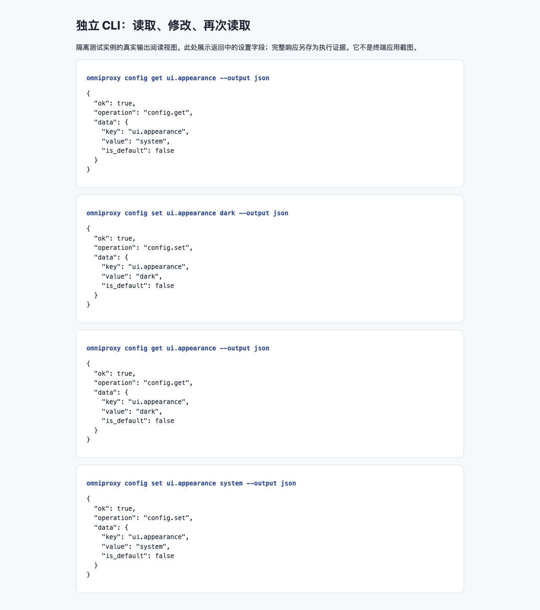

# 让 AI 工具帮你操作 OmniProxy

如果你使用的 AI 编程助手或 Agent 工具具备**本机终端命令执行能力**，你可以让它直接调用 `omniproxy` CLI，替你查询网关状态或修改指定配置（注意：仅能在网页或聊天框里生成文字建议、不具备本地命令执行权限的普通聊天工具，无法替你操作电脑）。

**开始前的注意事项**：
- 请先参阅[使用命令行与终端管理台](12-cli-runtime.md)，确认当前环境中独立 CLI 的路径（`command -v omniproxy`）与版本（`omniproxy --version`）正常可用。
- **注意数据隔离**：请勿将桌面端 `OmniProxy.app` 内部的 Helper 程序作为独立 CLI 使用，亦不要将 `--data-dir` 指向桌面端 App 的私有资料库。桌面端 App 请通过图形界面管理；AI Agent 操作的目标应为**独立 CLI 实例**。

## 1. 第一步：先让 AI 只读查询，禁止上来就改配置

首次把 OmniProxy 交给 AI 工具接管时，不要下达“帮我自动配好”之类含糊的指令。请先将下面这段提示词发给你的 AI 工具，要求它做一次纯只读的环境摸底：

> 请先确认本机 OmniProxy CLI 的完整程序路径、版本号和目标数据实例。先阅读 `omniproxy --help` 及相关子命令的帮助说明，然后查询当前网关能力快照与界面外观设置。**注意：本次仅执行只读查询，请勿下载或安装模型、请勿向外部发送测试内容、请勿修改任何配置**；请把查到的实际结果和当前不可用的项目如实汇报给我。

AI 应当依次执行以下只读命令：

```sh
omniproxy --version
omniproxy gateway capabilities --output json
omniproxy config get ui.appearance --output json
```

> **如何核对 AI 的查询汇报？**
> `gateway capabilities` 返回的能力快照只能帮 AI 了解当前登记了哪些模型、协议及它们的状态标记，**并不能代替一次真实的模型推理测试**。如果某个模型仅仅出现在目录中、尚未加入代理或状态显示为需重新测试，AI 绝不能仅凭快照里有这个名字就向你报告“该模型已可正常调用”。



*上图为隔离 CLI 实例真实返回字段的浏览器阅读视图（非终端软件截图，亦非原生 App 截图）。判断操作是否成功，必须以命令实际返回的 `ok: true` 及 `data.value` 字段为准，不能只听信 AI 在对话里回答“已完成”。*

## 2. 第二步：让 AI 执行一个可撤销的受控小修改

确认 AI 能够准确读取状态并记下当前的 `ui.appearance` 原值后，你可以向它下达一个范围明确、随时可回滚的配置修改任务。例如发送以下提示词：

> 请将刚才确认的那个 OmniProxy 独立 CLI 实例的外观设置修改为深色（`dark`）。修改前请先核对 `config set` 的 `--help` 帮助，执行修改后立即重新读取该项设置进行验证。**注意：请全程使用同一程序路径与相同的数据目录参数；请勿触碰桌面端 App 的数据，请勿修改任何模型来源或密钥凭据**；最后请把恢复为原值的准确命令一并提供给我。

AI 应当执行的命令序列为：

```sh
# 修改外观为 dark
omniproxy config set ui.appearance dark --output json

# 立即读回验证，确认返回的 data.value 为 "dark"
omniproxy config get ui.appearance --output json
```

如果第一步查到的初始原值确实是 `system`，那么用于恢复原状的命令就是（若原值为其他值，请让 AI 按实际记录的原值恢复，不要盲目照抄 `system`）：

```sh
omniproxy config set ui.appearance system --output json
```

**验收 AI 操作报告的四个核对项**：
1. 报告中是否明确列出了所调用的 `omniproxy` **完整程序路径**与**版本号**。
2. 是否说明了是否使用 `--data-dir` 参数及其具体路径，且在**读取、修改、恢复**三步中始终保持参数完全一致。
3. 修改后的读回验证 JSON 中，`ok` 是否为 `true`，且 `data.value` 是否确实变成了目标值。
4. 是否严格遵守了不触碰桌面端 App 私有资料库的边界。

## 3. 给 AI 下达日常运维指令的操作建议

下载模型、发起调用测试、执行网络搜索、删除数据或修改 API 密钥，都会直接带来**磁盘占用、上游计费、数据外发或配置丢失**等真实后果。因此，向 AI 下达指令时必须把“允许做什么”和“禁止做什么”说明清楚：

- **错误示范（边界模糊）**：“帮我检查并优化一下 OmniProxy 的模型来源配置。”
- **正确示范（边界清晰）**：“请列出当前独立 CLI 实例中的所有模型来源，找出哪些来源处于未验证状态并向我报告。**在得到我下一步确认前，禁止替换或清空任何密钥，禁止向外部发送生成测试请求**。”

始终要求 AI 遵循：**操作前先读取当前状态 → 在限定范围内执行单步修改 → 操作后立即读回验证 → 一旦遇到报错立即停止后续依赖步骤并原样报告错误**。

## 4. 识别错误码与预演边界

当 AI 解析 CLI 的 JSON 输出时，请督促它严格按以下规则判断：
- **先看 `ok` 再看 `data`**：只有当 `ok` 为 `true` 时才能读取 `data`；当 `ok` 为 `false` 时，必须读取 `error.code` 与错误描述。
- **区分预演与实操**：带有 `--dry-run` 参数的命令仅仅是预览可能发生的动作，**绝不代表配置已修改或服务已连通**。
- **遇到不支持的命令禁止瞎编**：如果命令返回 `capability_not_ready`、提示子命令不存在或当前发行物不支持，应立即核对 `--version` 与 `--help`，**请勿让 AI 自己猜测或编造未公开的替代命令与隐藏参数**。某一条查询命令执行成功，也不代表其他所有子命令在当前安装包中均已开放。

更多 CLI 子命令详情请参阅[使用命令行与终端管理台](12-cli-runtime.md)，配置网关固定路由名称请参阅[用固定名称映射模型](model-mapping.md)。
