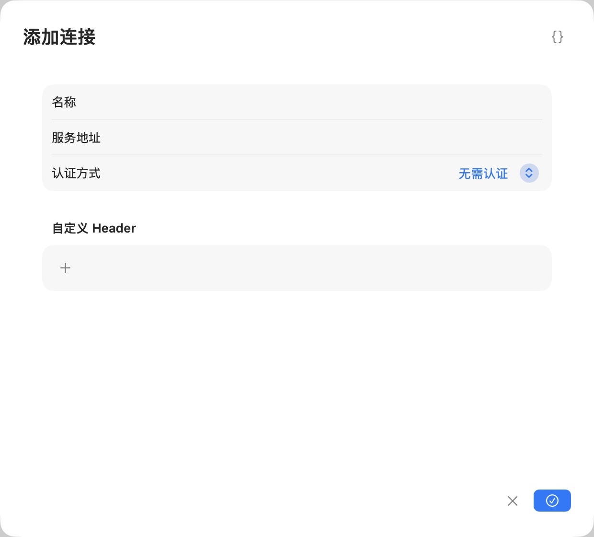

# 连接远程 MCP 服务

MCP 服务为支持它的 AI 工具提供工具等资源。这里连接的是远程服务，再向你的调用工具提供本机代理地址；它不是用来管理 OmniProxy 的另一套公开管理接口。

当前 MCP 是实验功能，默认关闭，后续版本可能调整。开始前准备从这台 Mac 可访问的 MCP 服务地址、所需认证以及你愿意授予该服务的能力范围。

## 显示入口并添加连接

1. 到“设置”开启“启用 MCP”。左侧资源区出现“MCP 服务”。
2. 打开“MCP 服务”，点击加号“添加连接”。
3. 填一个自己能辨认的“名称”和实际“服务地址”。这里不是让你填写一个本机可执行文件路径。
4. 按服务要求选择“认证方式”；需要时添加自定义 Header。不要将秘密写在连接名称里。
5. 保存后检查连接状态，按页面提供的验证或授权动作完成连接。

图中是空表单，尚未建立连接。认证方式必须与实际服务一致，不能因为默认显示“无需认证”就跳过供应商要求。

## 配置调用工具

连接状态为“可用”时，点击该连接行的复制图标取得完整本机代理地址。形式是 `http://127.0.0.1:实际端口/mcp/连接ID`，示例中的端口和 ID 不能照抄。它与模型的 `/v1/chat/completions` 是不同路径，不要在末尾再加 `/v1`，也不要把上游服务地址误当本机代理地址。

在支持远程 HTTP MCP 的 AI 工具中，把这个完整地址填为 MCP 服务 URL。网关已经配置代理密钥时，工具向本机代理发送 `Authorization: Bearer <你的代理密钥>`；密钥不在 URL 中。上游的 Bearer、OAuth 或自定义 Header 在 OmniProxy 的连接配置中管理，不能把上游凭据和本机代理密钥混用。

先在工具中查询工具清单，再执行一个低风险、明确授权的操作，检查结果；OmniProxy 连接行的调用次数与最近调用结果可辅助核对。地址指向本机，不直接作为其他电脑的可达地址。工具不支持该远程 MCP 方式或不能提供所需认证时，先查工具能力，不能把它当作本机命令式 MCP 服务来运行。

连接成功不表示可以授权它执行所有动作。服务可能读取文件、联网或改变外部数据，按实际工具能力和任务逐项决定。不要把上游凭据分散填进无关工具。

## 失败与停用

| 状态 | 下一步 |
| --- | --- |
| 需要授权 | 阅读实际授权范围，再通过页面的授权入口处理 |
| 验证失败 | 检查服务地址、认证、网络及服务支持的传输方式 |
| 修改后失效 | 重新验证当前配置，不依赖修改前的状态 |
| 暂时不使用 | 使用连接的停用操作；删除前确认调用工具不再依赖它 |

## MCP 的发送前脱敏范围

到“脱敏”页，在“按来源发送前脱敏”中找到这条 MCP 连接，单独配置“发送前脱敏”和“允许请求跳过脱敏”。模型来源的开关不会替它开启。启用后，受支持 MCP 请求中的工具参数文本等业务文本可以在外发前处理；工具名称、请求 ID、资源 URI 等控制字段不会被随意改写。无法安全保持协议含义的请求会拒绝，而不是带着原文自动重试。

这不包含返回结果的全面脱敏，也不是翻译式可逆恢复；媒体二进制和任意自定义 MCP 消息不因此受到保证。替换参数可能改变实际操作对象：先用虚构数据、只读操作验证参数与结果，再决定是否用于真实任务。服务认证由独立凭据配置负责。细节见[文本脱敏](11-redaction.md)，管理 OmniProxy 本身仍使用[CLI](12-cli-runtime.md)。
