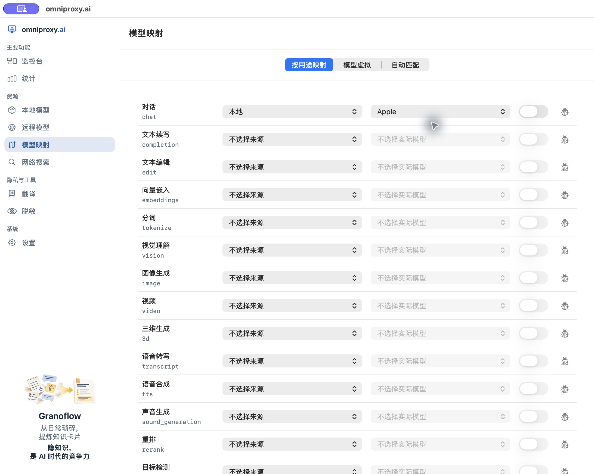
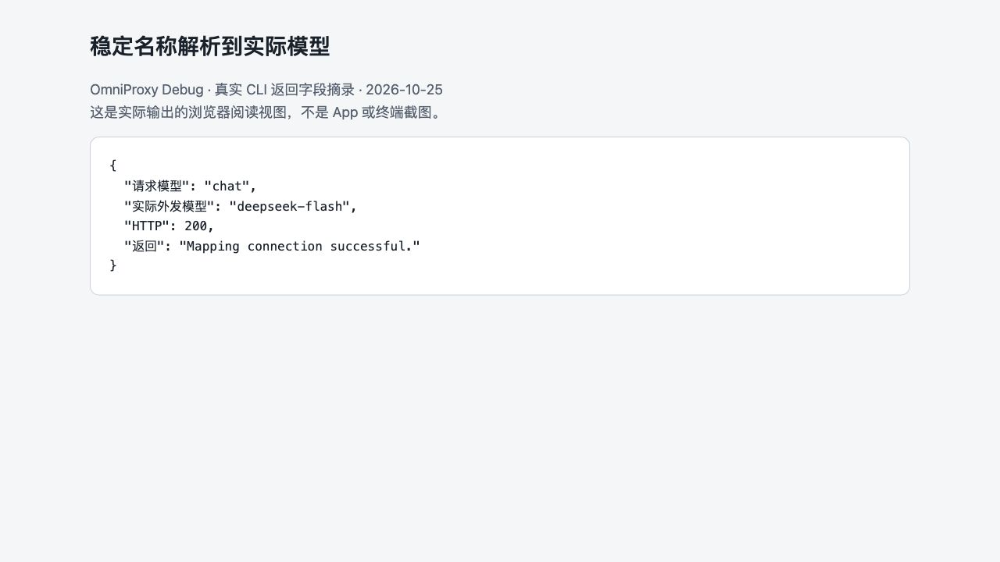

# 用固定名称映射模型

在第三方工具里直接填写具体模型名，一旦你想更换底层模型或遇到跨来源同名冲突，就得把所有工具的配置挨个改一遍。**模型映射**提供了三种路由方式，帮你在工具与底层模型之间建立一层稳定的固定入口：

1. **按用途映射**：工具统一请求 `chat` 等任务代号，你在 OmniProxy 里随时切换背后实际执行的模型。
2. **模型虚拟**：工具继续发送它写死的模型名（如某些客户端只允许请求特定的 ChatGPT 或 Claude 模型名），由 OmniProxy 在后台转发给你指定的其他模型。
3. **自动匹配（`auto-chat`）**：按你设定的候选优先级与判断模型，为当前请求挑选合适的模型。

**前置条件**：无论使用哪种映射，都必须先在[远程模型](06-external-models.md)或[本地模型](05-local-models.md)中完成来源验证与模型的真实调用测试。此外，映射只负责转发名称，工具发起的协议与输入格式仍需与目标模型支持的能力相匹配。

## 1. 按用途映射（以 `chat` 为例）

1. 打开左侧导航栏的**模型映射**，停留在**按用途映射**标签页。
2. 找到**对话**一行，名称下方的 `chat` 就是这项用途的固定请求标识。
3. 在第一列下拉框选择**来源**（本机模型选“本地”，云端模型选你添加的具体远程来源）。
4. 在第二列下拉框选择**实际模型**（切换来源后请重新核对模型，不要沿用另一来源的同名项）。
5. 若目标模型提示还需测试或准入，先按提示回模型页处理；就绪后打开该行的**启用开关**。
6. 点击行末的**测试代理**打开测试窗口：先核对顶部的 HTTP 方法、完整请求地址与请求正文（按用途测试使用的是该用途内置的标准调用方案，不支持在此随意篡改协议；若某用途暂未内置测试方案，会直接显示不可测试）。点击运行并确认响应正常后，即可去外部工具中使用。注意：若绑定的是外部云端模型，点击测试会真实外发请求并产生上游计费。



*上图为原生 App 的“按用途映射”界面。图中已为“对话（`chat`）”选定了“本地”来源与 Apple 模型，但右侧开关尚未打开，此时代理还未生效。若开关或测试图标呈灰色不可点状态，说明前置测试条件尚未满足，请先回模型或来源页完成验证。*

### 在外部工具中使用用途名称

保持工具里的网关 Base URL 和代理密钥不变，将 **Model / 模型 ID** 改为 `chat`。发送一句短消息后，前往**监控台**确认请求已正确解析到你绑定的实际模型。

> **能力与协议必须匹配**：用途名称不是能自动跨模态转换的“万能转换器”。文生图要调图片接口，语音朗读（如 `tts`）要调语音接口——把 `tts` 填进只会发纯文本聊天请求的工具里，是不可能收到音频文件的。若界面上某个用途显示限制原因、无可用候选或禁止启用，请按提示处理，不要试图强行绕过。

| 任务类型 | 接入前需核对的匹配项 |
| --- | --- |
| **对话** | 目标模型具备对话能力，且兼容工具实际发送的 Chat Completions / Responses / Messages 等协议。 |
| **文生图 / 图生图** | 目标模型具备对应图像能力，且接口与尺寸、图片输入约束相符。 |
| **朗读 / 语音转写** | 目标模型具备语音合成或识别能力，且音频输入/输出封装格式匹配。 |
| **视频生成** | 当前版本已配置可用的运行路径，且满足所需输入参数与返回产物要求。 |

### 无感切换背后的模型

当你想把 `chat` 背后的模型从模型 A 换成模型 B 时：
1. 先在模型页确认新模型 B 已测试通过。
2. 回到**模型映射 → 按用途映射**，在“对话”行更改来源和实际模型。
3. **关键步骤**：每次修改绑定目标后，**该行的启用开关会自动关闭**；请务必核对新目标无误后**重新手动打开开关**，切勿以为旧的开启状态会自动保留。
4. 外部工具保持 `chat` 不变，直接发一条测试消息，去监控台确认实际执行模型已变为新模型。

> **留意边界变化**：从本地模型切换到远程云端模型时，会带来上游 API 计费、网络延迟变化以及数据外发。切换前请先核对该远程来源的[发送前文本脱敏策略](11-redaction.md)。

### 用途映射真实调用示例

将 `chat` 绑定到已验证的远程 DeepSeek 来源（`deepseek-flash`）并开启开关后，在外部请求中指定模型名为 `chat`，发送：

```text
Reply exactly: Mapping connection successful.
```

网关实际将请求路由给 `deepseek-flash`，返回 `HTTP 200` 及正文 `Mapping connection successful.`。在监控台点开调用详情，同时看到**请求模型为 `chat`**、**实际模型为 `deepseek-flash`**，即证明映射已完整生效（我们同样验证了在保持请求名 `chat` 不变的前提下，依次按 `DeepSeek → Apple 本地模型 → DeepSeek` 切换目标并重开开关，工具端无需任何改动即可无缝切换本地与云端推理）。



*上图为 CLI 真实返回字段的浏览器阅读视图（非原生 App 截图），展示了请求名称 `chat` 被解析为实际模型 `deepseek-flash` 并成功返回的过程。*

## 2. 配置“模型虚拟”（保留工具原有模型名）

有些第三方客户端不允许填 `chat` 这样的自定义名字，或者会在后台硬编码请求特定的官方模型名。此时可以使用**模型虚拟**，在不改工具模型名的前提下接管请求：

1. 在**模型映射**页面切换到**模型虚拟**标签页。在 **ChatGPT** 或 **Claude** 分组下找到工具使用的名称。
2. 在对应协议分组下寻找工具将要请求的模型名称；若列表中没有，点击相应 **ChatGPT** 或 **Claude** 分组标题旁的**加号（+）“添加模型”**，输入工具实际发送的模型名称。
   - **命名规则**：虚拟名称不能重复、不能包含空格或斜杠 `/`，长度不超过 200 字节（因此不能把任意带 `/` 的上游完整路径 ID 直接当成虚拟名称新增）。
3. 在该行依次选择目标**模型来源**与**实际模型**（若候选显示不可用或需重测，请回来源或模型页修复，改虚拟名字无法绕过模型本身的校验）。
4. 等待绑定保存后，**打开该行的启用开关**，并点击**测试代理**验证请求与响应。注意：虚拟名称必须与其所在的协议分组匹配，把一个名字加在 ChatGPT 分组下不代表它就能接收 Claude 协议格式的请求。
5. 让外部工具直接发送该虚拟名称，随后去**监控台**核对实际执行的模型。

> **维护提示**：若日后修改了虚拟名称，外部工具也必须同步改名；删除一条虚拟映射只会移除这个转发名字和绑定关系，不会删除你的本地模型文件或取消云端订阅。

## 3. 配置“自动匹配”（`auto-chat`）

**自动匹配**提供一个固定的请求模型名 `auto-chat`。它会根据你设定的候选模型列表和顺序，判断并挑选适合当前具体任务的模型（注意：它只响应显式请求 `auto-chat` 的调用，不会在你请求重名的普通模型时自动出来替你消歧）。

1. 在**模型映射**页面切换到**自动匹配**标签页。
2. **添加并排序候选**：在“添加候选”下拉框中选择已验证的实际模型，点击旁边的**加号（+）**加入列表，使用上下箭头调整优先顺序。
3. **设置内容处理模式**：
   - **仅本地处理**：只允许从合格的本地模型中挑选。如果存在多个候选且需要借助云端模型做路由判断，则无法在“仅本地处理”模式下启用；若列表中只有一个合格的本地候选，则会直接选用它。
   - **允许外发（多候选判断）**：当配置了多个候选模型时，需要指定一个可用的**判断模型**。若所选判断模型或候选包含远程模型，你必须明确勾选同意**允许外发**——请注意，即便最终选中的是本地模型，在路由判断阶段你的任务内容也会先发送给云端判断模型（若不接受内容外发，请勿启用此配置）。
4. 打开**启用自动匹配**开关并点击**保存**（若提示候选不合格、判断模型不可用或配置未保存，请按提示逐一排除）。
5. **测试路由选择**：在页面下方的“测试任务”框中输入一项具体任务描述，点击**测试选择**，查看返回的“选中模型”与判断耗时。注意：**测试选择**仅测试“路由阶段会挑中谁”，不会真正调用最终模型生成回答；但若判断模型在云端，这一步测试本身仍会外发文本并产生判断调用的费用。
6. 在外部工具中将模型名设为 `auto-chat` 发起真实请求，最后到**监控台**核对最终执行的模型与输出正文。此后若修改了候选列表、顺序或判断设置，请记得重新保存并测试。

如果想让具备命令执行能力的 AI Agent 帮你查询或调整映射，请参阅[让 AI 工具帮你操作 OmniProxy](18-agent-capability-discovery.md)。
